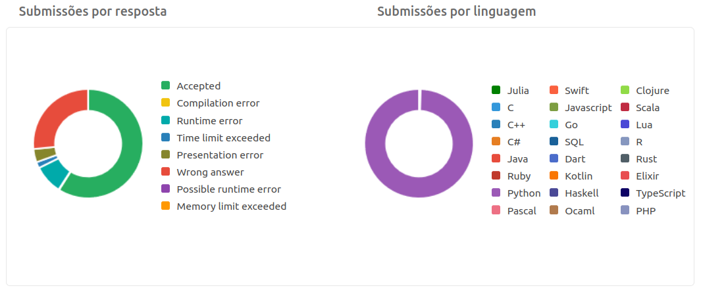
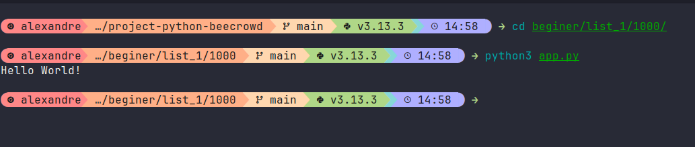

# Welcome

## About the Repository

This repository aims to develop solutions for questions from the [Beecrowd](https://judge.beecrowd.com/en/login) platform using programming logic concepts, focusing on Python, which is currently my study focus. Additionally, it aims to help beginners in their programming learning journey.

## Important Information

Only questions from the **Beginner** category of the platform will be provided. Questions from other categories may be solved in the future, depending on my availability.

All submissions on the platform were made between **05/14/2024** and **06/23/2024**.

In codes where there was consultation or use of code snippets, I will leave comments with the respective references.

## Development Environment

- **Operating System**: [Ubuntu 24.04 LTS](https://ubuntu.com/download/desktop)
- **Programming Language**: [Python 3.12.3](https://www.python.org/downloads/release/python-3123/)
- **Text Editor**: [Visual Studio Code](https://code.visualstudio.com/download)
- **Terminal**: [Fish](https://fishshell.com/)
- **Command Line Prompt**: [Starship](https://starship.rs/)
- **Python Formatting Extension**: [Ruff](https://astral.sh/ruff)

## Concepts Used

- Programming Logic
- Variable Types
- Conditional Structures
- Repetition Structures
- Lambda Expressions
- Data Structures (lists, matrices, dictionaries, tuples)
- Functions

## Folder Structure

```text
.
├── beginer
│   ├── list_1
│   │   ├── 1000
│   │   │   └── app.py
│   │   ├── 1001
│   │   │   └── app.py
│   │   └── ...
│   ├── list_2
│   ├── list_3
│   ├── list_4
│   ├── list_5
│   ├── list_6
│   ├── list_7
│   ├── list_8
│   ├── list_9
│   ├── list_10
│   ├── list_11
│   ├── list_12
│   ├── list_13
│   └── list_14
├── README.md
└── requirements.txt
```

## Unsolved Issues

| Issues                               | Status |
| ------------------------------------ | ------ |
| 3181 - Jantar                        | :x:    |
| 3229 - Resenhas de comida            | :x:    |
| 3230 - Senhores de Guerra Galácticos | :x:    |
| 3231 - Horror List                   | :x:    |
| 3232 - Infiltration                  | :x:    |
| 3233 - Suco                          | :x:    |
| 3234 - Kindergarten                  | :x:    |
| 3235 - Luggage                       | :x:    |
| 3250 - Problema no elevador          | :x:    |
| 3252 - Reus da Floresta              | :x:    |
| 3253 - Problemas com o Carro         | :x:    |
| 3255 - A vez do Primo                | :x:    |
| 3256 - Divisão Inimiga               | :x:    |
| 3258 - Fervendo Vegetais             | :x:    |
| 3267 - Passeio no Penhasco           | :x:    |
| 3306 - Consulta e Alteração          | :x:    |
| 3343 - Attack on Gasparini           | :x:    |

## Project Execution

To run the codes, follow these steps:

1. Create a virtual environment if you wish to install external dependencies.

   `python3 -m venv .venv`

   or

   `python -m venv .venv`

2. Activate the virtual environment.

   If using the fish terminal:

   `. .venv/bin/activate.fish`

   or

   `. .venv/bin/activate`

3. Install the desired dependency.

   `pip install dependency_name`

4. To generate the requirements file:

   `pip freeze > requirements.txt`

5. Access the directory of the script you want to run.

   `cd beginer/list_1/1000`

6. Execute the script.

   `python3 app.py`

   or

   `python app.py`

## Images

### Submission Statistics



### Execution Example


